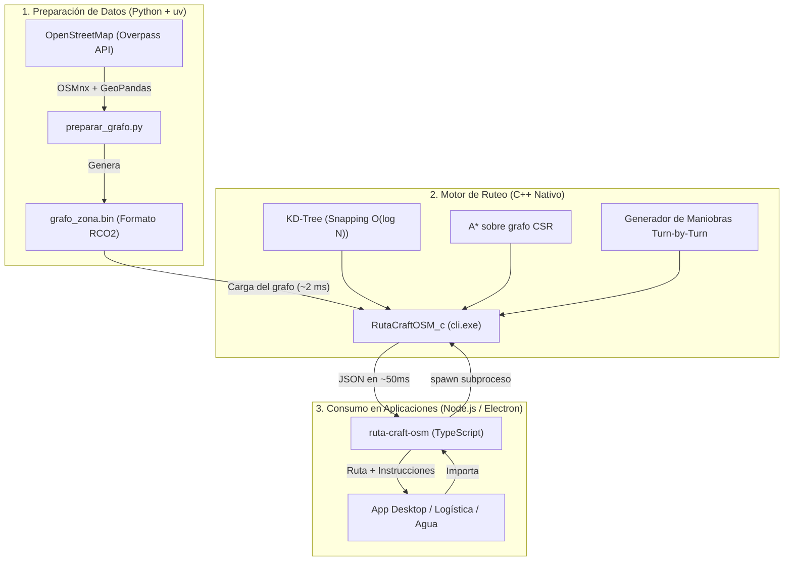

# 🏛️ 1. Arquitectura Global y Migración a C++

## 1. Visión General del Sistema

**RutaCraftOSM** utiliza una **arquitectura híbrida por capas**, separando estrictamente la preparación de datos geográficos de la ejecución del motor de ruteo en tiempo real:



---

## 2. ¿Por qué se migró el motor de Python a C++?

La versión original en Python (empaquetada con Nuitka) presentaba cuellos de botella inherentes al lenguaje y al empaquetado:

| Problema en Python / Nuitka | Solución en C++20 |
| :--- | :--- |
| **Búsqueda lineal $O(N)$ en snapping**: Para cada punto GPS se evaluaban los 24,465 nodos del grafo calculando Haversine en Python puro. Con 23 puntos, se ejecutaban más de 500,000 llamadas trigonométricas. | **KD-Tree espacial 2D**: Indexación espacial en memoria que reduce la búsqueda a $O(\log N)$ (apenas 15 a 20 operaciones por punto). |
| **Arranque en frío (*Cold Start*)**: Iniciar el runtime de Python, cargar módulos e inicializar la máquina virtual tardaba entre 200 ms y 500 ms en cada ejecución. | **Cero arranque en frío**: El ejecutable C++ arranca y carga el grafo de producción en **~2 ms**, y con el motor persistente esa carga se paga una sola vez ([ver benchmark](./5_RENDIMIENTO.md)). |
| **Estructuras en memoria dispersas**: Diccionarios de Python (`dict`) con claves `int64` y tuplas, provocando continuos fallos de caché de CPU (*cache misses*). | **Memoria contigua**: Uso de `std::vector` y tipos planos que aprovechan la memoria caché L1/L2/L3 del procesador. |
| **Dependencia de DLLs externas**: Nuitka requería distribuir `python311.dll`, `vcruntime140.dll`, `libcrypto` y múltiples archivos `.pyd` (pesando > 15 MB). | **Binario 100% estático**: Un solo archivo `.exe` compilado con `-static` sin ninguna dependencia externa. |

---

## 3. Validación de la Migración

Para confirmar que el motor C++ reemplaza al de Python sin cambiar los resultados, se ejecutó la comparación automatizada [`comparar_motores.py`](https://github.com/Mahynlo/RutaCraftOSM/blob/main/RutaCraftOSM/tests/comparar_motores.py) sobre **23 paradas GPS distribuidas a lo largo de los municipios de Mazatán y Villa Pesqueira**. La misma verificación (ruta y distancia idénticas) corre en cada push como parte de las pruebas del motor (`TestParidadPython` en `RutaCraftOSM_c/tests/test_cpp_cli.py`).

```text
============================================================
🔬 COMPARACIÓN DIRECTA: MOTOR PYTHON vs MOTOR C++
============================================================

⏱️ TIEMPOS DE EJECUCIÓN (23 puntos GPS en todo el municipio):
  • Python:  1076.76 ms
  • C++:     56.44 ms  (19.1x más rápido)

📏 DISTANCIA TOTAL CALCULADA:
  • Python:  14706.4 m  (14.71 km)
  • C++:     14706.4 m  (14.71 km)

📍 PUNTOS EN LA POLILÍNEA DE LA RUTA:
  • Python:  458 coordenadas generadas
  • C++:     458 coordenadas generadas

🧭 INSTRUCCIONES DE NAVEGACIÓN:
  • Python:  44 pasos
  • C++:     48 pasos

============================================================
Diferencia en distancia: 0.00 metros (0.000%)
✅ VERIFICACIÓN EXITOSA: Ambos motores producen resultados equivalentes.
============================================================
```

C++ genera más instrucciones (48 contra 44) porque, a diferencia del motor Python, lee los nombres de calle del grafo y separa los tramos cuando cambia la calle.

> [!TIP]
> El rendimiento actual del motor C++ (carga del grafo, motor persistente, ciudad de Hermosillo) está en **[5. Rendimiento del Motor C++](./5_RENDIMIENTO.md)**, y las rutas de esos escenarios se pueden ver en el **[Visualizador Web](./visualizacion_ruta.html)**.

---

## 4. Equivalencia Funcional 1:1

El motor en C++ reproduce las entradas, salidas y comportamientos del CLI original (referencia completa de opciones en [3. Motor C++](./3_MOTOR_CPP_RUTACRAFT.md#7-uso-de-la-cli)):

* **Formatos de entrada**: `--array lat1 lon1 lat2 lon2...`, `--puntos archivo.json`, `--puntos "[[lat, lon], ...]"` (incluso con longitudes negativas).
* **Gestión de grafos**: `--grafo <ruta>` (búsqueda automática en `grafos/` y soporte para binario `.bin` y `.json`).
* **Formatos de salida**: Salida por archivo con `--salida <ruta.json>` y salida por consola con `--stdout`.
* **Caché**: Carga y guardado de sub-rutas calculadas con soporte para `--no-save-cache`; `--sin-cache` desactiva por completo la lectura y escritura del caché.
* **Modo servidor** (solo C++): `--serve` carga el grafo una vez y atiende peticiones JSON línea por línea por stdin (`{"id":1,"puntos":[[lat,lon],...]}` → `{"id":1,"ok":true,"resultado":{...}}`). El caché se guarda al cerrarse stdin.
