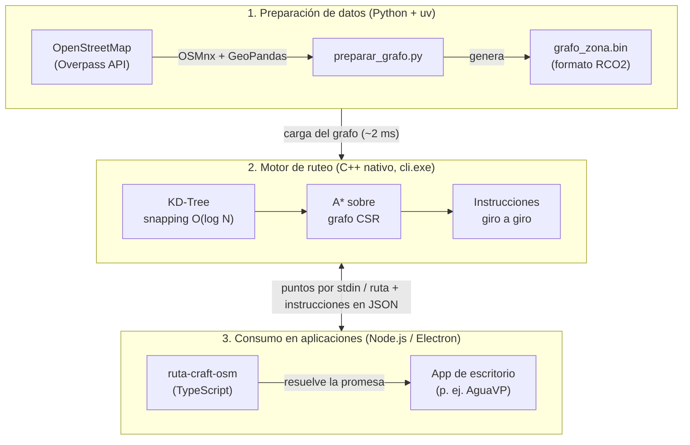

# 🏛️ 1. Arquitectura Global y Migración a C++

## Propósito y alcance

**RutaCraftOSM** es una librería ligera para **generar rutas de múltiples puntos** por calles reales, sin conexión a internet, dentro de una **zona específica**. Calcula la ruta por calles **más corta en distancia** que recorre una lista de paradas y la describe con instrucciones en español.

### Para qué sirve

Está pensada para aplicaciones que necesitan rutas en su propia zona de trabajo (un municipio, una ciudad, un conjunto de colonias) **sin instalar ni operar un servidor de ruteo** como OSRM, GraphHopper o Valhalla:

| Servidor de ruteo (OSRM, etc.) | RutaCraftOSM |
| :--- | :--- |
| Se instala y mantiene un servicio aparte (normalmente con Docker) y se preprocesa un mapa regional o de un país completo. | Un ejecutable incluido en el paquete npm y un archivo de grafo de pocos MB solo de la zona que se necesita. |
| La app depende de una conexión al servidor. | Corre dentro de la app, sin red. |
| Perfiles de vehículo, tiempos, tráfico y restricciones de giro. | Ruta más corta en distancia: lo necesario para recorrer una lista de paradas. |

Para usarla en una zona nueva:

1. Se genera el grafo de esa zona con el script de Python ([2. Pipeline Python](./2_IMPLEMENTACION_PYTHON_UV.md)).
2. Se pasa el archivo con la opción `grafo`.

El paquete incluye como ejemplo el grafo de Mazatán y Villa Pesqueira (Sonora), de unos 25 mil nodos y 1.3 MB. El benchmark también usa el de la ciudad de Hermosillo, de unos 75 mil nodos.

### Ejemplo de uso: AguaVP

AguaVP, un sistema de gestión de agua potable, la usa para generar las **rutas de lectura de medidores**:

1. Se eligen los medidores de una ruta.
2. El proceso *main* de Electron llama a `calcularRuta()` con sus coordenadas.
3. La app muestra en el mapa el trazado, la distancia y las instrucciones.
4. Los tramos quedan en un caché en la carpeta de datos de la app, para no recalcularlos.

### Qué hace

| Entrada | Salida |
| :--- | :--- |
| Lista de paradas `[lat, lon]` (la primera es el inicio). | Polilínea de la ruta por calles, distancia total y una instrucción por calle (*"Gira a la derecha en Calle Morelos"*, 120 m). |
| Opcional: `optimizar`, `regresarAlInicio` o `fijarFinal`. | Además, el orden de visita que recorre menos distancia y la distancia antes y después. |
| Opcional: `grafo` con la ruta de otro archivo `.bin`. | Las mismas salidas, en la zona de ese grafo. |

### Qué no hace todavía

La versión actual es intencionalmente simple. Varias de estas limitaciones son mejoras posibles a futuro:

| Limitación | Detalle | Posible mejora |
| :--- | :--- | :--- |
| Distancia, no tiempo | El peso de cada calle es su longitud en metros. No hay velocidades, jerarquía de vías ni tráfico, y no se estima la hora de llegada. | Exportar en el grafo un peso por tiempo (OSMnx puede estimar velocidades y `travel_time` por calle) y elegir el criterio al calcular. |
| Sentidos de las calles | El grafo de ejemplo los ignora y una ruta puede ir en contrasentido. | El motor ya acepta grafos dirigidos: basta generarlos con `respetar_sentido=True` ([2. Pipeline Python](./2_IMPLEMENTACION_PYTHON_UV.md)). |
| Sin restricciones de giro | No conoce giros prohibidos ni maniobras restringidas. | Leer las relaciones `restriction` de OpenStreetMap. |
| Solo automóvil | Se descargan las calles transitables en auto (`network_type="drive"`). | Generar grafos con otros perfiles (`walk`, `bike`). |
| Ajuste al nodo más cercano | Cada parada se ajusta al nodo del grafo más cercano (cruce o punto de una calle), no a la posición exacta sobre la calle. | Proyectar la parada sobre la arista más cercana. |
| Una zona por grafo | Solo hay ruta dentro del grafo cargado. No está pensado para grafos muy grandes, como un estado o un país completo. | — |
| Instrucciones estáticas | Se calculan una vez. No hay guía en tiempo real, seguimiento de la posición ni recálculo. | — |
| Optimización simple | Un vehículo, sin horarios ni capacidades. Con hasta 9 paradas el orden es el óptimo exacto; con más es una aproximación pensada para decenas de paradas. | Ventanas de horario o varios vehículos. |
| Nombres de calle | Dependen de OpenStreetMap: las calles sin nombre aparecen como `"desconocida"`. | — |

Este enfoque sirve cuando las rutas son de unas decenas de paradas dentro de una zona conocida, importa la distancia recorrida y la app debe funcionar sin internet ni infraestructura extra.

---

## 1. Visión General del Sistema

**RutaCraftOSM** separa en tres capas la preparación de los datos (una vez, con Python), el cálculo de rutas (C++) y su uso desde la app (npm):



---

## 2. ¿Por qué se migró el motor de Python a C++?

La versión original en Python (empaquetada con Nuitka) presentaba cuellos de botella inherentes al lenguaje y al empaquetado:

| Problema en Python / Nuitka | Solución en C++20 |
| :--- | :--- |
| **Búsqueda lineal $O(N)$ en snapping**: Para cada punto GPS se evaluaban los 24,465 nodos del grafo calculando Haversine en Python puro. Con 23 puntos, se ejecutaban más de 500,000 llamadas trigonométricas. | **KD-Tree espacial 2D**: Indexación espacial en memoria que reduce la búsqueda a $O(\log N)$ (apenas 15 a 20 operaciones por punto). |
| **Arranque en frío (*Cold Start*)**: Iniciar el runtime de Python, cargar módulos e inicializar la máquina virtual tardaba entre 200 ms y 500 ms en cada ejecución. | **Cero arranque en frío**: El ejecutable C++ arranca y carga el grafo de producción en **~2 ms**, y con el motor persistente esa carga se paga una sola vez ([ver benchmark](./5_RENDIMIENTO.md)). |
| **Estructuras en memoria dispersas**: Diccionarios de Python (`dict`) con claves `int64` y tuplas, provocando continuos fallos de caché de CPU (*cache misses*). | **Memoria contigua**: Uso de `std::vector` y tipos planos que aprovechan la memoria caché L1/L2/L3 del procesador. |
| **Dependencia de DLLs externas**: Nuitka requería distribuir `python311.dll`, `vcruntime140.dll`, `libcrypto` y múltiples archivos `.pyd` (pesando > 15 MB). | **Binario 100% estático**: Un solo archivo `.exe` compilado con `-static` sin ninguna dependencia externa. |

---

## 3. Validación de la Migración

Para confirmar que el motor C++ reemplaza al de Python sin cambiar los resultados, se ejecutó la comparación automatizada [`comparar_motores.py`](https://github.com/Mahynlo/RutaCraftOSM/blob/main/RutaCraftOSM/tests/comparar_motores.py) sobre **23 paradas GPS distribuidas a lo largo de los municipios de Mazatán y Villa Pesqueira**. La misma verificación (ruta y distancia idénticas) corre en cada push como parte de las pruebas del motor (`TestParidadPython` en `RutaCraftOSM_c/tests/test_cpp_cli.py`).

```text
============================================================
🔬 COMPARACIÓN DIRECTA: MOTOR PYTHON vs MOTOR C++
============================================================

⏱️ TIEMPOS DE EJECUCIÓN (23 puntos GPS en todo el municipio):
  • Python:  1076.76 ms
  • C++:     56.44 ms  (19.1x más rápido)

📏 DISTANCIA TOTAL CALCULADA:
  • Python:  14706.4 m  (14.71 km)
  • C++:     14706.4 m  (14.71 km)

📍 PUNTOS EN LA POLILÍNEA DE LA RUTA:
  • Python:  458 coordenadas generadas
  • C++:     458 coordenadas generadas

🧭 INSTRUCCIONES DE NAVEGACIÓN:
  • Python:  44 pasos
  • C++:     48 pasos

============================================================
Diferencia en distancia: 0.00 metros (0.000%)
✅ VERIFICACIÓN EXITOSA: Ambos motores producen resultados equivalentes.
============================================================
```

C++ genera más instrucciones (48 contra 44) porque, a diferencia del motor Python, lee los nombres de calle del grafo y separa los tramos cuando cambia la calle.

> [!TIP]
> El rendimiento actual del motor C++ (carga del grafo, motor persistente, ciudad de Hermosillo) está en **[5. Rendimiento del Motor C++](./5_RENDIMIENTO.md)**, y las rutas de esos escenarios se pueden ver en el **[Visualizador Web](./visualizacion_ruta.html)**.

---

## 4. Equivalencia Funcional 1:1

El motor en C++ reproduce las entradas, salidas y comportamientos del CLI original (referencia completa de opciones en [3. Motor C++](./3_MOTOR_CPP_RUTACRAFT.md#7-uso-de-la-cli)):

* **Formatos de entrada**: `--array lat1 lon1 lat2 lon2...`, `--puntos archivo.json`, `--puntos "[[lat, lon], ...]"` (incluso con longitudes negativas).
* **Gestión de grafos**: `--grafo <ruta>` (búsqueda automática en `grafos/` y soporte para binario `.bin` y `.json`).
* **Formatos de salida**: Salida por archivo con `--salida <ruta.json>` y salida por consola con `--stdout`.
* **Caché**: Carga y guardado de sub-rutas calculadas con soporte para `--no-save-cache`; `--sin-cache` desactiva por completo la lectura y escritura del caché.
* **Modo servidor** (solo C++): `--serve` carga el grafo una vez y atiende peticiones JSON línea por línea por stdin (`{"id":1,"puntos":[[lat,lon],...]}` → `{"id":1,"ok":true,"resultado":{...}}`). El caché se guarda al cerrarse stdin.
