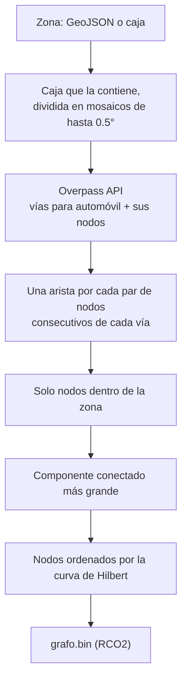

# 🗺️ 2. Generador de Grafos (TypeScript)

El grafo vial de una zona se genera con el mismo paquete npm, **sin Python**: el generador descarga las calles de OpenStreetMap con la API Overpass y escribe el archivo binario `RCO2` que carga el motor. Funciona igual en **Node 18+** y en el **navegador** (solo usa `fetch`).

Reemplaza al antiguo pipeline de Python con OSMnx y produce el mismo grafo: con el límite de Mazatán y Villa Pesqueira se obtienen los mismos 24,465 nodos y 49,556 aristas, con coordenadas idénticas y pesos que difieren en menos de una milésima de milímetro (redondeo a `float32`). Las rutas resultantes son idénticas.

---

## 1. Desde la línea de comandos

```powershell
# Zona definida por un GeoJSON (Polygon, MultiPolygon, Feature o FeatureCollection)
npx ruta-craft-osm generar --geojson datos/mazatan_villapesqueira.geojson --salida grafo.bin

# Zona rectangular: sur,oeste,norte,este
npx ruta-craft-osm generar --caja 28.97,-111.10,29.21,-110.86 --salida hermosillo.bin

# Respetar calles de un solo sentido
npx ruta-craft-osm generar --geojson zona.geojson --salida grafo.bin --respetar-sentido

# Guardar los datos descargados y regenerar después sin internet
npx ruta-craft-osm generar --geojson zona.geojson --salida grafo.bin --guardar-osm zona.osm.json
npx ruta-craft-osm generar --geojson zona.geojson --salida grafo_dirigido.bin --desde-osm zona.osm.json --respetar-sentido

# Resumen de un grafo
npx ruta-craft-osm info grafo.bin
```

| Opción | Efecto |
| :--- | :--- |
| `--geojson <archivo>` / `--caja s,o,n,e` | Zona del grafo. |
| `--salida <archivo>` | Archivo RCO2 a escribir. |
| `--respetar-sentido` | Respeta las calles de un solo sentido (por defecto se ignoran, como el grafo de producción). |
| `--guardar-osm` / `--desde-osm` | Guarda o reutiliza los datos crudos de Overpass. |
| `--overpass <url>` | Otro servidor de Overpass (p. ej. uno propio). |
| `--conservar-desconectados` | Conserva las calles que no están conectadas a la red principal. |
| `--sin-ref` | No usa la referencia de la vía (p. ej. `MEX 15`) como nombre cuando la calle no tiene nombre. |

`ruta-craft-osm reordenar entrada.bin salida.bin` renumera los nodos de un grafo generado con la versión anterior para que el motor sea más rápido (ver la sección 4); los grafos nuevos ya salen reordenados.

---

## 2. Desde código (Node o navegador)

```ts
import { generarGrafo } from "ruta-craft-osm";            // Node / Electron
// import { generarGrafo } from "ruta-craft-osm/web";     // navegador

const { bytes, estadisticas, datosOSM } = await generarGrafo({
    zona: geojson,                 // o caja: { sur, oeste, norte, este }
    respetarSentido: false,
    alProgresar: (mensaje) => console.log(mensaje),
});
fs.writeFileSync("grafo.bin", bytes);   // en el navegador: crearMotorWeb({ grafo: bytes })
```

También están las piezas por separado: `descargarOverpass()`, `construirGrafo()`, `escribirRCO2()`, `leerRCO2()`, `reordenarGrafo()` y `describirGrafo()`.

---

## 3. Qué hace el generador



1. **Descarga.** Pide a Overpass las vías con el mismo filtro que usaba OSMnx con `network_type="drive"`: excluye andadores, ciclovías, caminos de servicio, estacionamientos, vías privadas, etc. Las zonas grandes se piden en varios mosaicos y se unen sin duplicados. Si el servidor está ocupado (429/50x), reintenta con espera creciente.
2. **Aristas.** Cada par de nodos consecutivos de una vía es una arista, con su longitud de gran círculo (radio de 6,371,009 m, el de OSMnx). El nombre es la etiqueta `name` de la vía o, si no tiene, su `ref`.
3. **Sentidos** (con `respetarSentido`). Las mismas reglas que OSMnx: `oneway=yes/true/1` en el sentido de la vía, `oneway=-1/reverse` en sentido contrario, y las glorietas (`junction=roundabout`) son de un solo sentido.
4. **Recorte por la zona.** Se descartan los nodos fuera del polígono (respetando sus huecos) y las aristas que salen de él. Para que sea rápido aunque el límite municipal tenga miles de vértices, cada anillo reparte sus lados en franjas horizontales.
5. **Componente principal.** Se conserva solo el componente débilmente conectado más grande, como OSMnx, para que no queden calles aisladas donde una parada no tendría ruta.
6. **Una arista por par de nodos.** Si dos vías comparten un tramo, queda la más corta con el nombre de la primera.

---

## 4. Orden de los nodos (curva de Hilbert)

El generador numera los nodos siguiendo una curva de Hilbert: los nodos cercanos en el mapa quedan cercanos en memoria. A\* y Dijkstra recorren nodos vecinos, así que el procesador encuentra más datos en su caché. En Hermosillo esto redujo el tiempo de A\* entre 15% y 30% sin cambiar ninguna distancia.

---

## 5. Calles de un solo sentido

| `respetarSentido` | Comportamiento | Uso |
| :--- | :--- | :--- |
| `false` (por defecto) | Cada calle se puede recorrer en ambos sentidos: el motor **ignora** las calles de un solo sentido. | Grafo de producción actual (`grafo_mazatan_villapesqueira.bin`). |
| `true` | Las calles de un solo sentido solo tienen la arista en su sentido. | Rutas que respetan los sentidos; archivo más chico y carga más rápida. |

En Hermosillo, el 17.7% de las aristas son de un solo sentido y respetarlas alarga las rutas entre 1% y 12%. Ver la comparación completa en [5. Rendimiento](./5_RENDIMIENTO.md#5-calles-de-un-solo-sentido).

---

## 6. Formato RCO2

El formato del archivo está documentado en [3. Motor C++](./3_MOTOR_CPP_RUTACRAFT.md#2-especificación-del-formato-binario-rco2) y en el encabezado de [`rco2.ts`](https://github.com/Mahynlo/RutaCraftOSM/blob/main/ruta-craft-osm/src/generador/rco2.ts). El lector valida la estructura completa y rechaza archivos truncados o con índices fuera de rango.

---

## 7. Licencia de los datos

Los datos de OpenStreetMap están bajo la licencia [ODbL](https://www.openstreetmap.org/copyright). Si muestras rutas calculadas con estos grafos, incluye la atribución «© colaboradores de OpenStreetMap».

---

## 8. Pruebas

Las pruebas del generador ([`test/generador.test.mjs`](https://github.com/Mahynlo/RutaCraftOSM/blob/main/ruta-craft-osm/test/generador.test.mjs)) no usan internet. Cubren con un caso sintético cada regla (sentidos, filtro de vías, zona con hueco, componentes desconectados, nombres), la lectura y escritura byte a byte del grafo de producción, el reordenamiento sin cambios de distancia, la prueba de "punto en la zona" contra el límite municipal real y la descarga con un `fetch` simulado (mosaicos, reintentos y errores).

```powershell
cd ruta-craft-osm
npm test
```
