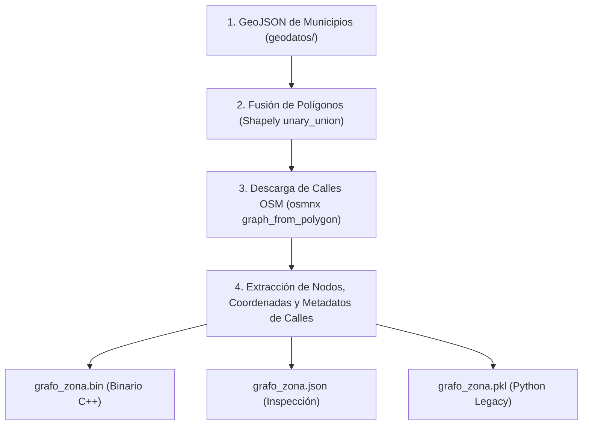

# 🐍 2. Pipeline de Datos en Python con `uv`

## 1. Gestión del Entorno con `uv`

Para la preparación de datos geográficos y las libretas de experimentación, se utiliza **`uv`**, el gestor de paquetes y entornos virtuales de Python de alta velocidad.

### Instalación y Creación del Entorno
```powershell
# Ubicarse en la carpeta Python
cd RutaCraftOSM

# Crear entorno virtual .venv
uv venv .venv

# Instalar dependencias científicas y de mapas
uv pip install osmnx geopandas shapely networkx ipykernel
```

### Ejecución de Scripts con `uv run`
Con `uv run`, los comandos se ejecutan automáticamente dentro del entorno virtual sin necesidad de activarlo manualmente:
```powershell
uv run python preparar_grafo.py
uv run python -m unittest discover -s tests -p "test_*.py"
```

---

## 2. Funcionamiento de `preparar_grafo.py`

El script [`preparar_grafo.py`](https://github.com/Mahynlo/RutaCraftOSM/blob/main/RutaCraftOSM/preparar_grafo.py) automatiza la extracción de las redes viales desde OpenStreetMap:



### Paso a paso del procesamiento:
1. **Carga y unión de polígonos**: Lee los límites de los municipios (ej. Mazatán y Villa Pesqueira) y los une en una sola geometría continua.
2. **Descarga de la red vial**: Descarga las calles de tipo `network_type="drive"` (apto para vehículos) respetando la topología real de las intersecciones (`simplify=False`).
3. **Extracción de atributos viales**:
   - `y`, `x`: Latitud y longitud exactas de cada nodo.
   - `length`: Longitud en metros de cada tramo vial.
   - `name`: Nombre de la calle (ej. *"Calle Hidalgo"* o *"Carretera Estatal 15"*).
   - `highway`: Categoría OSM de la vía (`residential`, `primary`, `secondary`, etc.).

---

## 3. Formatos de Salida Generados

Al ejecutarse, `preparar_grafo.py` genera tres archivos en la carpeta `grafos/`:

| Archivo | Formato | Propósito | Tiempo de Carga |
| :--- | :--- | :--- | :---: |
| `grafo_mazatan_villapesqueira.bin` | **Binario RCO1** | Consumo directo por el motor C++ | **~35 ms** |
| `grafo_mazatan_villapesqueira.json` | **JSON** | Inspección humana y debugging (el motor C++ también lo acepta) | ~440 ms |
| `grafo_mazatan_villapesqueira.pkl` | **Pickle** | Motor Python de referencia y prueba de paridad | ~80 ms |

> [!TIP]
> Usa siempre el `.bin` en producción: el motor C++ carga el JSON unas 13 veces más lento.

---

## 4. Calles de un Solo Sentido

`exportar_grafo_binario(G, salida_bin, respetar_sentido=False)` controla cómo se exportan las aristas:

| `respetar_sentido` | Comportamiento | Uso |
| :--- | :--- | :--- |
| `False` (por defecto) | Cada arista se agrega también en sentido contrario: el motor **ignora** las calles de un solo sentido. | Grafo de producción actual (`grafo_mazatan_villapesqueira.bin`). |
| `True` | Solo las aristas que trae OSMnx, que ya incluye ambos sentidos en las calles de doble sentido. | Rutas que respetan los sentidos; archivo ~40% más chico y carga más rápida. |

En Hermosillo, el 17.7% de las aristas son de un solo sentido y respetarlas alarga las rutas entre 1% y 12%. Ver la comparación completa en [5. Rendimiento](./5_RENDIMIENTO.md#4-calles-de-un-solo-sentido).

---

## 5. Grafo de Hermosillo para el Benchmark

[`generar_grafos_benchmark.py`](https://github.com/Mahynlo/RutaCraftOSM/blob/main/RutaCraftOSM/generar_grafos_benchmark.py) descarga la zona urbana de Hermosillo (~75 mil nodos) para medir el motor en una ciudad con muchas calles. Genera las dos variantes en `grafos/benchmark/`, carpeta ignorada por git:

```powershell
cd RutaCraftOSM
uv run python generar_grafos_benchmark.py
# grafos/benchmark/grafo_hermosillo.bin           (ignora sentidos)
# grafos/benchmark/grafo_hermosillo_dirigido.bin  (respeta sentidos)
```

---

## 6. Pruebas Unitarias de Python

Para verificar que el pipeline de Python funciona correctamente, se dispone de una suite de pruebas en `RutaCraftOSM/tests/`:

```powershell
uv run python -m unittest discover -s tests -p "test_*.py"
```

* [`test_cli.py`](https://github.com/Mahynlo/RutaCraftOSM/blob/main/RutaCraftOSM/tests/test_cli.py): Prueba entradas por `--array`, `--puntos` (archivo y JSON string) y exportación a `--salida`.
* [`test_cli_errores.py`](https://github.com/Mahynlo/RutaCraftOSM/blob/main/RutaCraftOSM/tests/test_cli_errores.py): Prueba manejo de errores (JSON malformado, número impar de coordenadas, falta de argumentos).
