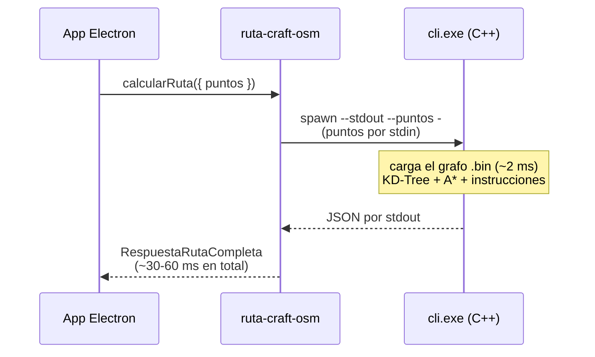
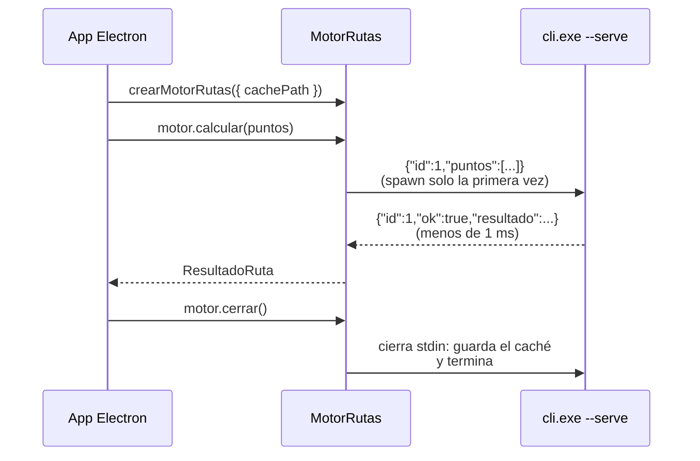

# 📦 4. Integración TypeScript, Electron y Navegador (`ruta-craft-osm`)

El paquete **`ruta-craft-osm`** es el *wrapper* tipado en TypeScript que lanza el motor C++ nativo desde Node.js o desde el proceso *main* de Electron (no desde el *renderer*, que no puede lanzar procesos). Para el navegador (o el *renderer*) incluye el mismo motor compilado a WebAssembly: ver la [sección 5](#5-navegador-webassembly). Por ejemplo, AguaVP lo usa en `src/generador_rutas/generar_ruta.js` para generar sus rutas de lectura de medidores.

---

## 1. ¿Cómo funciona la comunicación?

La librería interactúa con el binario nativo compilado mediante el módulo estándar `child_process.spawn`:



Además existe un **modo persistente** (`crearMotorRutas()`): se lanza una sola vez `cli.exe --serve`, que mantiene el grafo, el KD-Tree y el caché en memoria, y cada ruta viaja como una línea JSON por stdin/stdout:



| | `calcularRuta()` | `crearMotorRutas()` |
| :--- | :--- | :--- |
| Proceso | Uno nuevo por llamada | Uno persistente |
| Carga de grafo + KD-Tree | En cada llamada | Una sola vez |
| Tiempo por ruta, Mazatán - Villa Pesqueira (25 mil nodos) | ~30–60 ms | ~0.05–0.5 ms |
| Tiempo por ruta, ciudad de Hermosillo (75 mil nodos) | ~45–50 ms | ~2–3 ms |
| Caché en disco | Se lee y guarda en cada llamada | Se lee al iniciar, se guarda en `cerrar()` |

Cifras medidas en [5. Rendimiento del Motor C++](./5_RENDIMIENTO.md). Como la mayor parte del tiempo de `calcularRuta()` es arrancar el proceso y cargar el grafo, en Electron conviene usar el motor persistente.

---

## 2. Plataformas y Empaquetado con Electron

El paquete incluye un motor por plataforma y un grafo compartido:

```text
ruta-craft-osm/bin/
├── win32-x64/cli.exe
├── linux-x64/cli
├── darwin-x64/cli          (macOS Intel)
├── darwin-arm64/cli        (macOS Apple Silicon)
└── grafos/grafo_mazatan_villapesqueira.bin
```

El wrapper elige el binario con `process.platform` y `process.arch` (`plataformaActual()` devuelve, por ejemplo, `"win32-x64"`). Si el paquete no incluye esa plataforma, `calcularRuta()` y `motor.calcular()` se rechazan con un mensaje que la nombra. En Linux y macOS, si el binario perdió el permiso de ejecución (por ejemplo al descomprimir un zip), el wrapper lo restaura.

> [!NOTE]
> Los binarios no se guardan en git. La CI compila y prueba las cuatro plataformas, y el paquete de cada [release](https://github.com/Mahynlo/RutaCraftOSM/releases) las incluye todas.

Si la ruta del paquete pasa por `app.asar` (Electron empaquetado en producción), el wrapper usa `app.asar.unpacked`, porque un ejecutable no puede lanzarse desde dentro del archivo `.asar`. electron-builder desempaqueta automáticamente todo el módulo cuando encuentra un ejecutable; para no depender de esa detección, se puede declarar explícitamente:

```yaml
asarUnpack:
  - node_modules/ruta-craft-osm/bin/**
```

La constante `GRAFO_INCLUIDO` contiene la ruta absoluta del grafo del paquete, que se usa cuando no se pasa la opción `grafo`.

---

## 3. Tipos e Interfaces de TypeScript

```typescript
/** Opciones de orden de las paradas (calcularRuta() y motor.calcular()) */
export interface OpcionesOrden {
    optimizar?: boolean;        // Reordenar para minimizar la distancia (la primera parada es el inicio)
    regresarAlInicio?: boolean; // Terminar en el punto de inicio
    fijarFinal?: boolean;       // Al optimizar, mantener la última parada al final
}

export interface CalcularRutaOptions extends OpcionesOrden {
    puntos: [number, number][]; // Array de coordenadas [latitud, longitud]
    grafo?: string;             // Grafo .bin propio (por defecto GRAFO_INCLUIDO)
    cachePath?: string;         // Archivo de caché a leer/guardar. Sin él no se toca ningún archivo de caché
    saveCache?: boolean;        // Si es false, no guarda el caché en disco
    timeoutMs?: number;         // Tiempo máximo de ejecución (default: 30000)
}

export interface MotorRutasOptions {
    grafo?: string;
    cachePath?: string;         // Se lee al iniciar y se guarda al llamar cerrar()
    saveCache?: boolean;        // Si es false, el caché solo vive en memoria
    timeoutMs?: number;         // Tiempo máximo por petición (default: 30000)
}

export interface InstruccionNavegacion {
    accion: string;             // "Sigue recto", "Gira a la derecha", "Da vuelta en U", etc.
    calle: string;              // Nombre de la calle de OSM ("desconocida" si no tiene)
    desde: [number, number];    // Coordenada inicial del tramo
    hacia: [number, number];    // Coordenada final del tramo
    distancia_m: number;        // Distancia del tramo en metros
}

export interface ResultadoRuta {
    puntos_gps: [number, number][];        // Paradas en orden de visita
    ruta: [number, number][];              // Polilínea completa de la ruta
    distancia_total_m: number;
    distancia_total_km: number;
    instrucciones: InstruccionNavegacion[];
    orden?: number[];                      // Solo con optimizar o regresarAlInicio: índice en la entrada de cada parada
    optimizacion?: {                       // Solo con optimizar
        distancia_original_m: number;
        distancia_optimizada_m: number;
        metodo: "exacto" | "heuristico";
    };
}

export interface RespuestaRutaCompleta {
    resultado: ResultadoRuta;
    cache?: Record<string, string[]>;
}

export class ErrorRutaCraft extends Error {
    readonly codigo: CodigoErrorRuta;      // Ver la tabla de errores más abajo
}
```

### Errores

Todas las promesas se rechazan con `ErrorRutaCraft`, cuyo `codigo` no cambia entre versiones aunque cambie el texto del mensaje:

| `codigo` | Cuándo |
| :--- | :--- |
| `ENTRADA_INVALIDA` | Puntos fuera de rango o no numéricos, opciones incompatibles (`regresarAlInicio` + `fijarFinal`) |
| `GRAFO_INVALIDO` | El grafo no existe o el archivo es inválido |
| `SIN_RUTA` | Algún tramo entre paradas no tiene camino posible |
| `TIMEOUT` | Se superó `timeoutMs` |
| `PLATAFORMA_NO_SOPORTADA` | El paquete no incluye el motor para este sistema operativo y arquitectura |
| `MOTOR_NO_DISPONIBLE` | El motor no pudo ejecutarse o terminó inesperadamente |
| `INTERNO` | Error inesperado del motor |

```javascript
const { ErrorRutaCraft } = require('ruta-craft-osm');

try {
  const ruta = await motor.calcular(puntos);
} catch (e) {
  if (e instanceof ErrorRutaCraft && e.codigo === 'SIN_RUTA') {
    mostrarAviso('No hay camino por calle entre algunas paradas');
  } else {
    throw e;
  }
}
```

---

## 4. Instalación y Uso en Proyectos

### Paso 1: Instalar el paquete

Desde [GitHub Releases](https://github.com/Mahynlo/RutaCraftOSM/releases), en la raíz de tu proyecto (Electron, Node o web):

```powershell
npm install https://github.com/Mahynlo/RutaCraftOSM/releases/download/v0.2.0/ruta-craft-osm-0.2.0.tgz
```

El paquete ya trae los motores de Windows, Linux y macOS, el WebAssembly y el grafo de ejemplo.

### Paso 2 (opcional): usar una versión compilada por ti

Para probar cambios del motor o del wrapper sin publicar una versión:

```powershell
cd ruta-craft-osm
npm install
npm run build              # compila TypeScript (y copia el WebAssembly si lo compilaste)
npm pack                   # crea ruta-craft-osm-<versión>.tgz
```

En la app usa `"ruta-craft-osm": "file:ruta/al/ruta-craft-osm-<versión>.tgz"` en `package.json`. Antes de `npm pack` copia tu `cli` compilado a `bin/<plataforma>/`, porque los binarios no están en git. `npm link` también funciona mientras desarrollas.

### Paso 3: Ejemplo de código en JavaScript / TypeScript
```javascript
const os = require('os');
const path = require('path');
const { calcularRuta } = require('ruta-craft-osm');

async function obtenerRutaLecturas() {
  try {
    const respuesta = await calcularRuta({
      puntos: [
        [29.065639, -110.056448], // Inicio (Punto 1)
        [29.062039, -110.059091], // Medidor 2
        [29.059486, -110.053973], // Medidor 3
        [29.118091, -109.970340]  // Destino final
      ],
      cachePath: path.join(os.tmpdir(), 'cache_rutas.json'), // en Electron, usa app.getPath('userData')
      saveCache: true
    });

    const { ruta, distancia_total_km, instrucciones } = respuesta.resultado;

    console.log(`Distancia Total: ${distancia_total_km} km`);
    console.log(`Coordenadas en el trazado: ${ruta.length}`);

    instrucciones.forEach((inst, i) => {
      console.log(`${i + 1}. ${inst.accion} en ${inst.calle} (${inst.distancia_m} m)`);
    });

    return ruta;
  } catch (error) {
    console.error("Error al calcular ruta:", error);
  }
}
```

> [!NOTE]
> Las coordenadas se validan antes de llamar al motor (números finitos, latitud ±90, longitud ±180). Si algún tramo no tiene ruta posible, la promesa se rechaza en lugar de devolver una ruta incompleta.
>
> Los puntos se envían al motor por stdin, así que no hay límite práctico de paradas por ruta. El proceso se lanza con `windowsHide: true` (sin ventana de consola) y las rutas de `cachePath` o `grafo` pueden contener acentos.

### Paso 4 (recomendado en Electron): motor persistente
En el proceso *main* de Electron, crea un único motor y reutilízalo en cada petición IPC. Guarda el caché en `userData`, que siempre tiene permisos de escritura (el directorio de trabajo de una app instalada puede no tenerlos):

```javascript
const { app } = require('electron');
const path = require('path');
const { crearMotorRutas } = require('ruta-craft-osm');

const motor = crearMotorRutas({
  cachePath: path.join(app.getPath('userData'), 'cache_rutas.json')
});

// El proceso se inicia solo en la primera llamada y se reinicia si termina inesperadamente
const resultado = await motor.calcular([
  [29.065639, -110.056448],
  [29.059486, -110.053973]
]);
console.log(`${resultado.distancia_total_km} km`);

// Al salir, cerrar el motor para que guarde el caché en disco
app.on('before-quit', () => motor.cerrar());
```

| Método | Descripción |
| :--- | :--- |
| `crearMotorRutas(opciones?)` | Crea el motor. El proceso `cli.exe --serve` se inicia en la primera llamada a `calcular()`. |
| `motor.calcular(puntos, opciones?)` | Devuelve una `Promise<ResultadoRuta>`. `opciones` acepta `optimizar`, `regresarAlInicio` y `fijarFinal`. Acepta llamadas en paralelo; cada una se rechaza con `ErrorRutaCraft` si falla. |
| `motor.cerrar()` | Cierra el proceso y guarda el caché en `cachePath` (si `saveCache` no es `false`). Si el proceso termina inesperadamente, la siguiente llamada lo reinicia. |

### Paso 5: optimizar el orden de las paradas
Para una ruta de lectura de medidores, el motor puede decidir en qué orden visitar las paradas para recorrer lo menos posible. La primera parada siempre es el punto de inicio:

```javascript
const ruta = await motor.calcular(medidores, { optimizar: true, regresarAlInicio: true });

console.log(`${ruta.optimizacion.distancia_original_m} m -> ${ruta.optimizacion.distancia_optimizada_m} m`);

// ruta.orden[i] es el índice en `medidores` de la parada i-ésima del recorrido
const medidoresEnOrden = ruta.orden.map(i => medidores[i]);
```

Con hasta 9 paradas el orden es el óptimo exacto; con más, una heurística (vecino más cercano + 2-opt + Or-opt) que nunca empeora el orden recibido. Una ruta de 50 paradas en toda la ciudad de Hermosillo se optimiza en ~0.1 s con el motor nativo (~0.5 s con WebAssembly). Detalles del algoritmo en [3. Motor C++](./3_MOTOR_CPP_RUTACRAFT.md#8-optimización-del-orden-de-las-paradas).

> [!NOTE]
> Los cambios de cada versión del paquete están en [`ruta-craft-osm/CHANGELOG.md`](https://github.com/Mahynlo/RutaCraftOSM/blob/main/ruta-craft-osm/CHANGELOG.md). Si vienes de 0.0.7, la versión 0.1.0 cambió el comportamiento (distancia corregida, errores tipados, instrucciones agrupadas por calle); 0.2.0 es compatible con 0.1.0.

---

## 5. Navegador (WebAssembly)

`ruta-craft-osm/web` es el mismo motor C++ compilado a WebAssembly. Corre dentro de un **Web Worker** para no congelar la página y da exactamente las mismas respuestas que el motor nativo (las pruebas lo comparan byte a byte). Puedes probarlo en la **[demo en el navegador](./demo.html)**.

```ts
import { crearMotorWeb } from "ruta-craft-osm/web";

const motor = await crearMotorWeb({ grafo: "/grafos/mi_zona.bin" });   // URL o bytes del grafo
const ruta = await motor.calcular([[29.0656, -110.0564], [29.0620, -110.0590]], { optimizar: true });
console.log(ruta.distancia_total_km, ruta.instrucciones);
await motor.cerrar();
```

| | Node / Electron (`ruta-craft-osm`) | Navegador (`ruta-craft-osm/web`) |
| :--- | :--- | :--- |
| Motor | `cli.exe` nativo (un proceso) | `motor.wasm` (317 KB) en un Web Worker |
| Grafo | Ruta de archivo | URL o `Uint8Array` |
| Caché | Archivo JSON (`cachePath`) | En memoria: `exportarCache()` / `importarCache()` (guárdalo donde quieras, p. ej. IndexedDB) |
| Optimizar 50 paradas en una ciudad | ~0.1 s (varios hilos) | ~0.5 s (un hilo) |
| Errores | `ErrorRutaCraft` con `codigo` | Igual |

`MotorWeb` tiene la misma forma que `MotorRutas`: `calcular()`, `cambiarGrafo()`, `exportarCache()`, `importarCache()` y `cerrar()`. Si un cálculo supera `timeoutMs` (30 s por defecto), el Worker se termina y el siguiente cálculo arranca uno nuevo.

**Empaquetadores.** El Worker se crea con `new Worker(new URL("./worker.js", import.meta.url), { type: "module" })` y el módulo busca `motor.wasm` junto a `motor.mjs`, patrones que reconocen Vite, webpack 5 y esbuild. Si tu configuración los mueve, usa las opciones `wasmUrl` (dónde quedó `motor.wasm`) o `crearWorker` (cómo crear el Worker).

**Sin Worker.** `cargarMotorWasm({ grafo })` crea el motor en el hilo actual con llamadas síncronas (`motor.calcular()` devuelve el resultado directamente). Sirve dentro de un Worker propio o en Node, donde también funciona.

**Generar el grafo en el navegador.** `generarGrafo()` también funciona en la página: descarga la zona de Overpass y devuelve los bytes, que se pasan a `crearMotorWeb({ grafo: bytes })` o a `motor.cambiarGrafo(bytes)`. Ver [2. Generador de grafos](./2_GENERADOR_DE_GRAFOS.md).

> [!NOTE]
> El servidor debe servir `motor.wasm` con el tipo `application/wasm` (GitHub Pages, Vite, Netlify y la mayoría lo hacen). WebGPU no se usa: A\* es secuencial y con grafos de decenas de miles de nodos pasar los datos a la GPU costaría más que el cálculo, que tarda pocos milisegundos.
