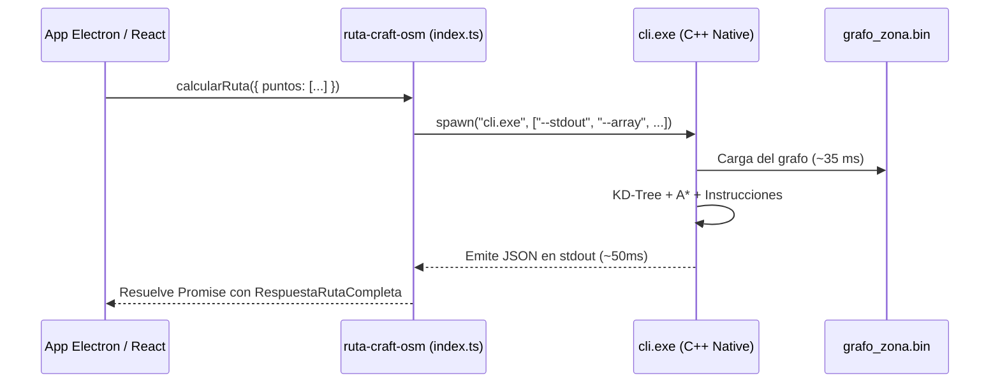
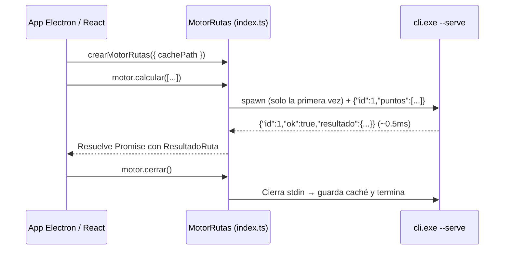

# 📦 4. Integración TypeScript y Electron (`ruta-craft-osm`)

El paquete **`ruta-craft-osm`** es el puente (*wrapper*) tipado en TypeScript para consumir el motor de ruteo nativo desde Node.js, Electron o aplicaciones frontend de escritorio.

---

## 1. ¿Cómo funciona la comunicación?

La librería interactúa con el binario nativo compilado mediante el módulo estándar `child_process.spawn`:



Además existe un **modo persistente** (`crearMotorRutas()`): se lanza una sola vez `cli.exe --serve`, que mantiene el grafo, el KD-Tree y el caché en memoria, y cada ruta viaja como una línea JSON por stdin/stdout:



| | `calcularRuta()` | `crearMotorRutas()` |
| :--- | :--- | :--- |
| Proceso | Uno nuevo por llamada | Uno persistente |
| Carga de grafo + KD-Tree | En cada llamada | Una sola vez |
| Tiempo por ruta (zona Mazatán–Villa Pesqueira) | ~65 ms | ~0.5 ms |
| Caché en disco | Se lee y guarda en cada llamada | Se lee al iniciar, se guarda en `cerrar()` |

---

## 2. Detección Automática de Entorno (Electron vs Node)

En [`src/index.ts`](file:///C:/Users/ASUS/Documents/Agua_VP_Electron/Ruta_craft/RutaCraftOSM/ruta-craft-osm/src/index.ts), la función `getCliExePath()` resuelve el binario relativo al propio paquete. Si la ruta pasa por `app.asar` (Electron empaquetado en producción), la redirige a `app.asar.unpacked`, porque un ejecutable no puede lanzarse desde dentro del archivo `.asar`:

```typescript
function getCliExePath(): string {
    const binaryName = process.platform === "win32" ? "cli.exe" : "cli";
    return path
        .join(__dirname, "..", "bin", "cli", binaryName)
        .replace(/app\.asar([\\/])/, "app.asar.unpacked$1");
}
```

> [!IMPORTANT]
> Al empaquetar con `electron-builder` o `electron-forge`, asegúrate de incluir en tu configuración `asarUnpack: ["**/node_modules/ruta-craft-osm/bin/**"]` para que el ejecutable `cli.exe` y el archivo `grafo.bin` queden fuera del archivo comprimido `.asar`.

---

## 3. Tipos e Interfaces de TypeScript

```typescript
export interface CalcularRutaOptions {
    puntos: [number, number][]; // Array de coordenadas [latitud, longitud]
    grafo?: string;             // Ruta al archivo de grafo .bin o .json
    cachePath?: string;         // Archivo de caché a leer/guardar. Sin él no se toca ningún archivo de caché
    saveCache?: boolean;        // Si es false, no guarda el caché en disco
    timeoutMs?: number;         // Tiempo máximo de ejecución (default: 30000)
}

export interface MotorRutasOptions {
    grafo?: string;
    cachePath?: string;         // Se lee al iniciar y se guarda al llamar cerrar()
    saveCache?: boolean;        // Si es false, el caché solo vive en memoria
    timeoutMs?: number;         // Tiempo máximo por petición (default: 30000)
}

export interface InstruccionNavegacion {
    accion: string;             // "Sigue recto", "Gira a la derecha", etc.
    calle: string;              // Nombre de la calle de OSM
    desde: [number, number];    // Coordenada inicial del tramo
    hacia: [number, number];    // Coordenada final del tramo
    distancia_m: number;        // Distancia del tramo en metros
}

export interface ResultadoRuta {
    puntos_gps: [number, number][];
    ruta: [number, number][];   // Polilínea completa de la ruta
    distancia_total_m: number;  // Distancia acumulada en metros
    distancia_total_km: number; // Distancia en kilómetros
    instrucciones: InstruccionNavegacion[];
}

export interface RespuestaRutaCompleta {
    resultado: ResultadoRuta;
    cache?: Record<string, string[]>;
}
```

---

## 4. Instalación Local y Uso en Proyectos

### Paso 1: Compilar y enlazar el paquete localmente
```powershell
# 1. Ubicarse en la carpeta del paquete
cd ruta-craft-osm

# 2. Compilar TypeScript
npm run build

# 3. Registrar enlace global de npm
npm link
```

### Paso 2: Usar en tu proyecto de Electron / Node.js
```powershell
# En la raíz de tu proyecto Electron
npm link ruta-craft-osm
```

### Paso 3: Ejemplo de código en JavaScript / TypeScript
```javascript
const { calcularRuta } = require('ruta-craft-osm');

async function obtenerRutaLecturas() {
  try {
    const respuesta = await calcularRuta({
      puntos: [
        [29.065639, -110.056448], // Inicio (Punto 1)
        [29.062039, -110.059091], // Medidor 2
        [29.059486, -110.053973], // Medidor 3
        [29.118091, -109.970340]  // Destino final
      ],
      cachePath: './cache_rutas.json',
      saveCache: true
    });

    const { ruta, distancia_total_km, instrucciones } = respuesta.resultado;

    console.log(`Distancia Total: ${distancia_total_km} km`);
    console.log(`Coordenadas en el trazado: ${ruta.length}`);

    instrucciones.forEach((inst, i) => {
      console.log(`${i + 1}. ${inst.accion} en ${inst.calle} (${inst.distancia_m} m)`);
    });

    return ruta;
  } catch (error) {
    console.error("Error al calcular ruta:", error);
  }
}
```

> [!NOTE]
> Las coordenadas se validan antes de llamar al motor (números finitos, latitud ±90, longitud ±180). Si algún tramo no tiene ruta posible, la promesa se rechaza en lugar de devolver una ruta incompleta.

### Paso 4 (recomendado en Electron): motor persistente
En el proceso *main* de Electron, crea un único motor y reutilízalo en cada petición IPC. Guarda el caché en `userData`, que siempre tiene permisos de escritura (el directorio de trabajo de una app instalada puede no tenerlos):

```javascript
const { app } = require('electron');
const path = require('path');
const { crearMotorRutas } = require('ruta-craft-osm');

const motor = crearMotorRutas({
  cachePath: path.join(app.getPath('userData'), 'cache_rutas.json')
});

// El proceso se inicia solo en la primera llamada y se reinicia si termina inesperadamente
const resultado = await motor.calcular([
  [29.065639, -110.056448],
  [29.059486, -110.053973]
]);
console.log(`${resultado.distancia_total_km} km`);

// Al salir, cerrar el motor para que guarde el caché en disco
app.on('before-quit', () => motor.cerrar());
```
