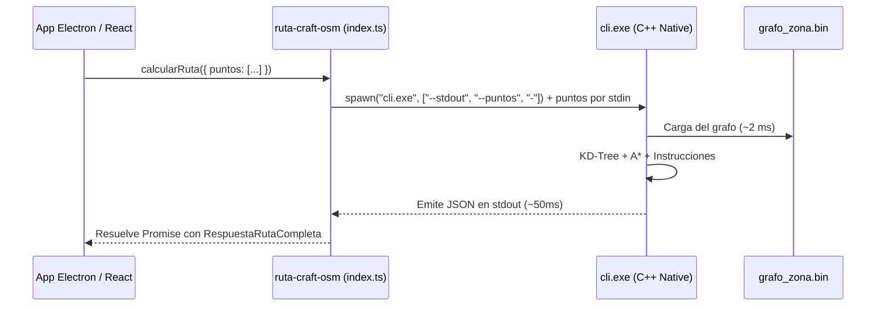

# 📦 4. Integración TypeScript y Electron (`ruta-craft-osm`)

El paquete **`ruta-craft-osm`** es el puente (*wrapper*) tipado en TypeScript para consumir el motor de ruteo nativo desde Node.js, Electron o aplicaciones frontend de escritorio.

---

## 1. ¿Cómo funciona la comunicación?

La librería interactúa con el binario nativo compilado mediante el módulo estándar `child_process.spawn`:



Además existe un **modo persistente** (`crearMotorRutas()`): se lanza una sola vez `cli.exe --serve`, que mantiene el grafo, el KD-Tree y el caché en memoria, y cada ruta viaja como una línea JSON por stdin/stdout:


| | `calcularRuta()` | `crearMotorRutas()` |
| :--- | :--- | :--- |
| Proceso | Uno nuevo por llamada | Uno persistente |
| Carga de grafo + KD-Tree | En cada llamada | Una sola vez |
| Tiempo por ruta, Mazatán - Villa Pesqueira (25 mil nodos) | ~30–60 ms | ~0.05–0.5 ms |
| Tiempo por ruta, ciudad de Hermosillo (75 mil nodos) | ~45–50 ms | ~2–3 ms |
| Caché en disco | Se lee y guarda en cada llamada | Se lee al iniciar, se guarda en `cerrar()` |

Cifras medidas en [5. Rendimiento del Motor C++](./5_RENDIMIENTO.md). Como la mayor parte del tiempo de `calcularRuta()` es arrancar el proceso y cargar el grafo, en Electron conviene usar el motor persistente.

---

## 2. Plataformas y Empaquetado con Electron

El paquete incluye un motor por plataforma y un grafo compartido:

```text
ruta-craft-osm/bin/
├── win32-x64/cli.exe
├── linux-x64/cli
├── darwin-x64/cli          (macOS Intel)
├── darwin-arm64/cli        (macOS Apple Silicon)
└── grafos/grafo_mazatan_villapesqueira.bin
```

El wrapper elige el binario con `process.platform` y `process.arch` (`plataformaActual()` devuelve, por ejemplo, `"win32-x64"`). Si el paquete no incluye esa plataforma, `calcularRuta()` y `motor.calcular()` se rechazan con un mensaje que la nombra. En Linux y macOS, si el binario perdió el permiso de ejecución (por ejemplo al descomprimir un zip), el wrapper lo restaura.

> [!NOTE]
> El repositorio solo versiona el binario de Windows (`bin/win32-x64/`), que es el que usa AguaVP. La CI compila y prueba las cuatro plataformas y publica un paquete con todas en el artefacto **`ruta-craft-osm-multiplataforma`**.

Si la ruta del paquete pasa por `app.asar` (Electron empaquetado en producción), el wrapper usa `app.asar.unpacked`, porque un ejecutable no puede lanzarse desde dentro del archivo `.asar`. electron-builder desempaqueta automáticamente todo el módulo cuando encuentra un ejecutable; para no depender de esa detección, se puede declarar explícitamente:

```yaml
asarUnpack:
  - node_modules/ruta-craft-osm/bin/**
```

La constante `GRAFO_INCLUIDO` contiene la ruta absoluta del grafo del paquete, que se usa cuando no se pasa la opción `grafo`.

---

## 3. Tipos e Interfaces de TypeScript

```typescript
export interface CalcularRutaOptions {
    puntos: [number, number][]; // Array de coordenadas [latitud, longitud]
    grafo?: string;             // Ruta al archivo de grafo .bin o .json
    cachePath?: string;         // Archivo de caché a leer/guardar. Sin él no se toca ningún archivo de caché
    saveCache?: boolean;        // Si es false, no guarda el caché en disco
    timeoutMs?: number;         // Tiempo máximo de ejecución (default: 30000)
}

export interface MotorRutasOptions {
    grafo?: string;
    cachePath?: string;         // Se lee al iniciar y se guarda al llamar cerrar()
    saveCache?: boolean;        // Si es false, el caché solo vive en memoria
    timeoutMs?: number;         // Tiempo máximo por petición (default: 30000)
}

export interface InstruccionNavegacion {
    accion: string;             // "Sigue recto", "Gira a la derecha", etc.
    calle: string;              // Nombre de la calle de OSM
    desde: [number, number];    // Coordenada inicial del tramo
    hacia: [number, number];    // Coordenada final del tramo
    distancia_m: number;        // Distancia del tramo en metros
}

export interface ResultadoRuta {
    puntos_gps: [number, number][];
    ruta: [number, number][];   // Polilínea completa de la ruta
    distancia_total_m: number;  // Distancia acumulada en metros
    distancia_total_km: number; // Distancia en kilómetros
    instrucciones: InstruccionNavegacion[];
}

export interface RespuestaRutaCompleta {
    resultado: ResultadoRuta;
    cache?: Record<string, string[]>;
}
```

---

## 4. Instalación Local y Uso en Proyectos

### Paso 1: Compilar y enlazar el paquete localmente
```powershell
# 1. Ubicarse en la carpeta del paquete
cd ruta-craft-osm

# 2. Instalar dependencias de desarrollo y compilar TypeScript
npm install
npm run build

# 3. (Opcional) Ejecutar las pruebas del wrapper
npm test

# 4. Registrar enlace global de npm
npm link
```

> [!TIP]
> Para instalarlo como archivo en lugar de con `npm link`, genera el paquete con `npm pack` (crea `ruta-craft-osm-<versión>.tgz`) y en la app usa `"ruta-craft-osm": "file:ruta/al/ruta-craft-osm-<versión>.tgz"` en `package.json`. Vuelve a generarlo cada vez que cambie el motor o el wrapper.

### Paso 2: Usar en tu proyecto de Electron / Node.js
```powershell
# En la raíz de tu proyecto Electron
npm link ruta-craft-osm
```

### Paso 3: Ejemplo de código en JavaScript / TypeScript
```javascript
const os = require('os');
const path = require('path');
const { calcularRuta } = require('ruta-craft-osm');

async function obtenerRutaLecturas() {
  try {
    const respuesta = await calcularRuta({
      puntos: [
        [29.065639, -110.056448], // Inicio (Punto 1)
        [29.062039, -110.059091], // Medidor 2
        [29.059486, -110.053973], // Medidor 3
        [29.118091, -109.970340]  // Destino final
      ],
      cachePath: path.join(os.tmpdir(), 'cache_rutas.json'), // en Electron, usa app.getPath('userData')
      saveCache: true
    });

    const { ruta, distancia_total_km, instrucciones } = respuesta.resultado;

    console.log(`Distancia Total: ${distancia_total_km} km`);
    console.log(`Coordenadas en el trazado: ${ruta.length}`);

    instrucciones.forEach((inst, i) => {
      console.log(`${i + 1}. ${inst.accion} en ${inst.calle} (${inst.distancia_m} m)`);
    });

    return ruta;
  } catch (error) {
    console.error("Error al calcular ruta:", error);
  }
}
```

> [!NOTE]
> Las coordenadas se validan antes de llamar al motor (números finitos, latitud ±90, longitud ±180). Si algún tramo no tiene ruta posible, la promesa se rechaza en lugar de devolver una ruta incompleta.
>
> Los puntos se envían al motor por stdin, así que no hay límite práctico de paradas por ruta. El proceso se lanza con `windowsHide: true` (sin ventana de consola) y las rutas de `cachePath` o `grafo` pueden contener acentos.

### Paso 4 (recomendado en Electron): motor persistente
En el proceso *main* de Electron, crea un único motor y reutilízalo en cada petición IPC. Guarda el caché en `userData`, que siempre tiene permisos de escritura (el directorio de trabajo de una app instalada puede no tenerlos):

```javascript
const { app } = require('electron');
const path = require('path');
const { crearMotorRutas } = require('ruta-craft-osm');

const motor = crearMotorRutas({
  cachePath: path.join(app.getPath('userData'), 'cache_rutas.json')
});

// El proceso se inicia solo en la primera llamada y se reinicia si termina inesperadamente
const resultado = await motor.calcular([
  [29.065639, -110.056448],
  [29.059486, -110.053973]
]);
console.log(`${resultado.distancia_total_km} km`);

// Al salir, cerrar el motor para que guarde el caché en disco
app.on('before-quit', () => motor.cerrar());
```

| Método | Descripción |
| :--- | :--- |
| `crearMotorRutas(opciones?)` | Crea el motor. El proceso `cli.exe --serve` se inicia en la primera llamada a `calcular()`. |
| `motor.calcular(puntos)` | Devuelve una `Promise<ResultadoRuta>`. Acepta llamadas en paralelo; cada una se rechaza si supera `timeoutMs` o si el tramo no tiene ruta. |
| `motor.cerrar()` | Cierra el proceso y guarda el caché en `cachePath` (si `saveCache` no es `false`). Si el proceso termina inesperadamente, la siguiente llamada lo reinicia. |
